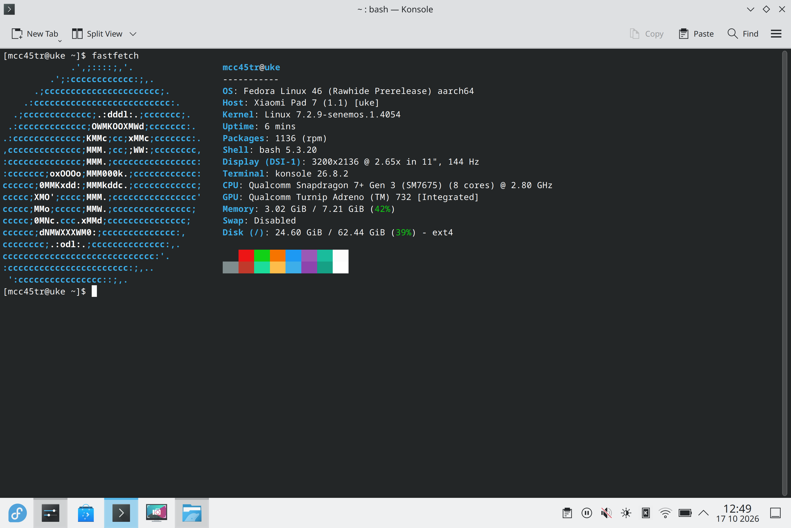
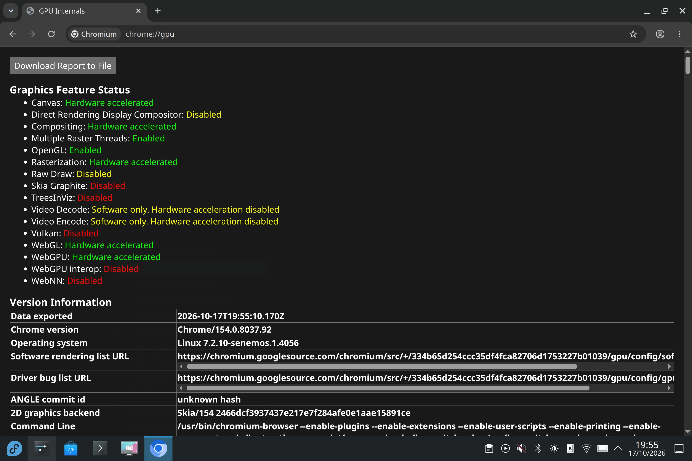

# Uke Fedora

[](https://github.com/linuxgamer/uke-fedora/actions/workflows/build-image.yml)

Fedora Linux port made for **Xiaomi Pad 7** and **POCO Pad X1**, based on [MCC45TR's port](https://github.com/MCC45TR/uke-linux).

This port is **work in progress**. Differences are: Fedora 44, `/userdata` install, more DEs, build optimisations, polishing and extra QoL stuff.

> [!WARNING]
> This is not ready for daily use. Installing to `userdata` overwrites Android user data. Back up any data you have!

## Start here

- **Installing the port:** read the [installation guide](docs/INSTALL.md) and the
  [releases](https://github.com/linuxgamer/uke-fedora/releases).
- **Developing the port:** read [docs/DEVELOPING.md](docs/DEVELOPING.md) for the
  environment, checks and contribution flow, then [AGENTS.md](AGENTS.md) for the
  rules. Current facts are in [docs/STATE.md](docs/STATE.md), ordered work in
  [docs/BACKLOG.md](docs/BACKLOG.md).

## Hardware support

| Component | Status | Notes |
| --- | --- | --- |
| Fedora KDE desktop | 🟢 Working | Boots into KDE; basic use and touch-only setup tested. |
| GNOME desktop | 🟢 Working | The GNOME image boots and works. |
| Other desktops | ⚪ Not verified | TTY, Phosh and Plasma Mobile still need tablet testing. |
| TTY touch keyboard | ⚪ Not verified | An experimental framebuffer keyboard is included in TTY images; it has not been tested on the tablet. |
| Display | 🟡 Partial | Native TM display works; a brief grey screen appears during boot. CSOT is untested on this port. |
| Refresh rate | 🟡 Partial | TM switches between the modes offered in KDE; sustained operation is untested. VRR is disabled. |
| Touchscreen | 🟡 Partial | Works, multitouch is unreliable. |
| Graphics (GPU) | 🟡 Partial | OpenGL works, Vulkan is experimental. |
| CPU and storage | 🟢 Working | All CPU cores are available, internal storage works. |
| Wi-Fi | 🟢 Working | Connects to networks and supports normal data transfers. |
| Bluetooth | 🟡 Partial | Mouse and headphone playback worked on one tablet; another installer reports Bluetooth failure in [issue #5](https://github.com/linuxgamer/uke-fedora/issues/5). |
| Auto-rotation | 🟢 Working | Screen and touch orientation follow tablet rotation. |
| Other sensors | 🟡 Partial | Motion, compass, proximity and cover detection have varying levels of support. |
| USB-C accessories | 🟡 Partial | An OTG mouse works through a USB-A-to-USB-C adapter; manual USB ACM on/off works. Other accessories need testing. |
| External display | ⚪ Not verified | Video output over USB-C/HDMI/DP has not been tested. |
| Charging | 🟡 Partial | Charging and battery percentage are detected, fast charging, charge limits and bypass may not work. |
| Sleep and wake | 🟡 Partial | Basic suspend exists, but wake is unreliable. |
| Reboot and shutdown | 🟡 Partial | Reboot works in some tests, shutdown can hang or restart the tablet. |
| Built-in speakers and microphones | 🔴 Not working | No functional playback or recording yet. |
| Cameras | 🔴 Not working | Neither camera has a verified working capture. |
| Stylus | 🔴 Not working | Pen input, pressure and tilt are unavailable. |
| Magnetic keyboard | ⚪ Not verified | Pogo keyboard and touchpad support have not been tested. |

🟢 Working · 🟡 Partial · 🔴 Not working · ⚪ Not verified

Developer-level evidence and blockers: [docs/HARDWARE.md](docs/HARDWARE.md).

## Screenshots

| KDE Plasma | GPU and Vulkan |
| --- | --- |
|  |  |

Screenshots are from upstream and will be replaced; they are not evidence that every block works in the current release.

## Downloads and building

Go to [releases](https://github.com/linuxgamer/uke-fedora/releases) and download the KDE or GNOME image. Then look at the [installation guide](docs/INSTALL.md).

To build separate Fedora 44 images on an x86_64 PC, use
`./uke-fedora-builder/build-images.sh --cross-kernel --output build/<DESIRED FOLDER>`.
By default all desktop variants are built, add `--profiles <ANY DE YOU WANT>,<DE 2>` to select DEs.
`--cross-kernel` speeds up the kernel compilation by running Clang natively
on the x86 PC, other packages and rootfs still use AArch64 containers. On an ARM64
host, omit the flag. Host requirements and the first-hour setup are in
[docs/DEVELOPING.md](docs/DEVELOPING.md); see the
[build guide](https://github.com/linuxgamer/uke-fedora-builder/blob/main/docs/BUILDING.md) and the
[cache guide](https://github.com/linuxgamer/uke-fedora-builder/blob/main/docs/BUILD-CACHE.md)
for cache, resume and rebuild options.

Package updates can be published to COPR; see [docs/COPR.md](docs/COPR.md).

## Source

This repository brings together the following components as submodules:

| Component | Repository |
| --- | --- |
| Kernel and device trees | [senemos-uke-kernel-mainline](https://github.com/linuxgamer/senemos-uke-kernel-mainline) |
| Hardware support and packages | [uke-linux-hardware-support](https://github.com/linuxgamer/uke-linux-hardware-support) |
| Fedora image builder | [uke-fedora-builder](https://github.com/linuxgamer/uke-fedora-builder) |

To clone with the submodules:

```sh
git clone --recurse-submodules https://github.com/linuxgamer/uke-fedora.git
```
