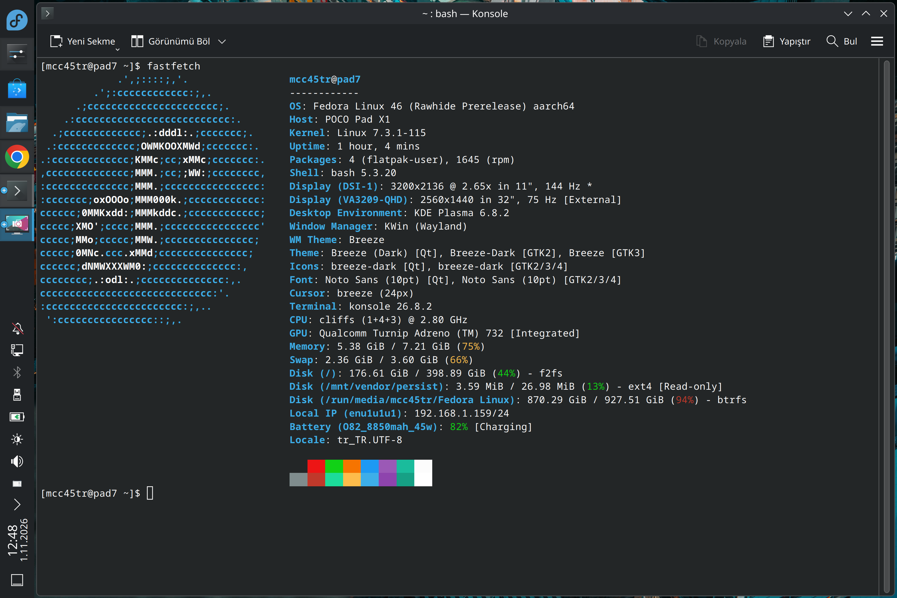

<table>
<tr>
<td width="65%" valign="top">
<h1>Uke Linux</h1>
<p><strong>Fedora Rawhide for Xiaomi Pad 7 and POCO Pad X1</strong></p>
<p>A community Linux port for the Snapdragon 7+ Gen 3 (SM7675), running the standard Fedora KDE Plasma desktop.</p>
<p><strong>Experimental alpha</strong> · AArch64 · <code>uke</code></p>
</td>
<td width="35%" valign="top" align="center">
<br>

</td>
</tr>
<tr>
<td colspan="2" align="center">

</td>
</tr>
</table>

[Downloads](#downloads) · [Hardware support](#hardware-support) · [Build from source](#build-from-source) · [Documentation](#documentation) · [Report a problem](CONTRIBUTING.md)

> [!WARNING]
> This is experimental software, provided as is. Back up your data before installing. The singleboot image erases Android data, and charging protection is not fully verified. Use it at your own risk.

## Project status

**Last updated: 29 October 2026.**

Fedora Rawhide and KDE Plasma run on the tested **POCO Pad X1, 8 GB / 512 GB**. The screen, touch, Wi-Fi, Bluetooth mouse and stereo audio, automatic rotation, automatic brightness, and internal speakers work. HDMI output and monitor audio also work through the tested Juo JH925 dock.

Charging protection, suspend, microphones, cameras, and sustained hardware video still need work. VRR remains disabled because it causes touch issues. External DSC/FEC produces a black image; automatic recovery to uncompressed output works in the latest test. See the [changelog](CHANGELOG.md) for development updates.

The latest recorded development boot is **7.3.0-48**, on **29 October 2026**, using the stock Android bootloader. These results are separate from the downloadable image below.

## Distribution roadmap

**Fedora Rawhide is the only active distribution port.** The intended primary
branch is `Fedora`. Ubuntu and Arch Linux editions are planned, but neither
has a qualified image, installer, or physical-device result. Shared kernel,
device support and boot experiments do not constitute distro support.

Past TEST and EL2/KVM work is retained in Git history for future reference,
without replacing the currently reviewed Fedora submodule pins. See the
[distribution roadmap and consolidated branch notes](DISTRIBUTIONS.md).

## Downloads

The [KDE EXT4 singleboot testing image](https://github.com/MCC45TR/uke-linux/releases/tag/prebuild-fedora-kde-singleboot-ext4-20261026-k7.3.0-16-testing), published on **26 October 2026**, includes signed **Linux 7.3.0-16** and matching modules. These files have passed checks on the build host but **have not yet been tested on a tablet**.

| File | Download size | Installation target |
| --- | ---: | --- |
| [boot.img](https://github.com/MCC45TR/uke-linux/releases/download/prebuild-fedora-kde-singleboot-ext4-20261026-k7.3.0-16-testing/boot.img) | 96 MiB | `boot_b` |
| [system.img.zst](https://github.com/MCC45TR/uke-linux/releases/download/prebuild-fedora-kde-singleboot-ext4-20261026-k7.3.0-16-testing/system.img.zst) | 991 MiB | Decompress to `system.img`, then flash to `userdata` |

The system image is an Android sparse image compressed with Zstandard, with an initial **16 GiB EXT4 filesystem**. Read the release instructions for checksums, storage requirements, installation, and recovery before flashing.

**Flashing `userdata` deletes Android apps, files, and encryption metadata. This image does not provide a data-preserving dual-boot installation.**

> [!IMPORTANT]
> Touchscreen setup requires a device-specific reference file that is not included in the image. Follow the release instructions to provide your tablet's own file before creating an account using touch. Do not use a file from another tablet. Setup using only a USB keyboard or mouse has not been verified.

First setup, filesystem expansion, updates, and recovery still need full testing with this image. Package sources and test results are listed in the [release record](https://github.com/MCC45TR/uke-linux-images/tree/main/releases/prebuild-fedora-kde-singleboot-ext4-20261026-k7.3.0-16-testing).

[All releases](https://github.com/MCC45TR/uke-linux/releases) · [Development packages on COPR](https://copr.fedorainfracloud.org/coprs/mcc45tr/uke-linux-test/) · [Archived images](https://github.com/MCC45TR/uke-linux-images/releases) · [Experimental OrangeFox builds](https://github.com/MCC45TR/orangefox_device_xiaomi_uke/releases)

## Hardware support

These results cover Fedora Rawhide AArch64 development builds tested between **14 and 29 October 2026** on the **POCO Pad X1, 8 GB / 512 GB**. Some tests used earlier kernels and have not been repeated on 7.3.0-48. They do not establish support in the downloadable image. Xiaomi Pad 7 and other memory/storage variants remain untested.

🟢 Working in the listed tests · 🟡 Partial · 🔴 Not working · ⚪ Not verified · ⏸️ Disabled

<details>
<summary><strong>Boot, CPU and storage</strong></summary>

| Feature | Status | Notes |
| --- | --- | --- |
| Fedora boot | 🟢 Working | Linux 7.3.0-48 boots through the stock Android bootloader at EL1 with matching modules. |
| CPU and power profiles | 🟢 Working | All eight cores and three frequency policies work. Sustained loads need more testing. |
| RAM | 🟢 Working | Linux reports 7.21 GiB; sustained stress testing remains incomplete. |
| UFS storage and EXT4 | 🟢 Working | Basic read/write tests, scaling, and WriteBooster work. |
| UFS MCQ and inline encryption | 🟡 Partial | MCQ starts and a 32 MiB direct read passes. ICE registers; concurrent queues and encrypted I/O remain unverified. |
| Memory bandwidth and cache monitoring | 🟡 Partial | CPU/DDR monitors and eight cache counters respond. Counter units, scaling, and MEMLAT policy need more work. |
| Reboot | 🟢 Working | Returns to the tested Linux installation. |
| Shutdown | 🟡 Partial | Occasional hangs; shutdown with USB power connected can restart the tablet. |
| Reboot to Fastboot | 🟢 Working | Bootloader entry works. |
| Reboot to recovery | ⚪ Not verified | Not tested from the current Fedora kernel. |
| UEFI, EL2 and KVM | ⚪ Not verified | Separate experimental work; not used for the Fedora results above. |

</details>

<details>
<summary><strong>Display, graphics and input</strong></summary>

| Feature | Status | Notes |
| --- | --- | --- |
| Internal display | 🟢 Working | Native display output at 3200×2136. |
| Fixed refresh rates | 🟢 Working | 30, 48, 50, 60, 90, 120, and 144 Hz. |
| Manual brightness | 🟢 Working | Backlight adjustment works. |
| Screen off/on | 🟡 Partial | Display returns, but occasional display timeouts remain. |
| Color depth | 🟡 Partial | Active 10-bit framebuffer and DSC link; output depth cannot be selected. |
| Touchscreen | 🟢 Working | Finger and multi-touch input work on the configured installation. Gestures and suspend/resume need more testing. |
| Adaptive sync / VRR | ⏸️ Disabled | Causes touch and display faults. |
| KDE Plasma / Wayland | 🟡 Partial | Desktop and applications work. Scrolling stutter, stalls during cover transitions under load, and a clipboard-related shutdown hang remain. |
| Adreno 732 / OpenGL | 🟡 Partial | Desktop rendering works. Broader API and sustained-load testing remain incomplete. |
| Vulkan / OpenCL | 🟡 Partial | Some transfer and compute tests pass; Vulkan image tests still fail. |
| Browser graphics / WebGPU | 🟡 Partial | GL works; operation with the GPU sandbox is unverified. Chrome has no WebGPU adapter. |
| Power and volume buttons | 🟢 Working | Normal input works; waking from suspend is unverified. |
| Stylus | 🟡 Partial | Pen input works, but pressure sensitivity and tilt are not supported yet. |
| USB mouse | 🟢 Working | Tested with a receiver through the powered Juo dock. |
| USB and pogo keyboards | ⚪ Not verified | Keyboard input and pogo touchpad support have not been tested. |

</details>

<details>
<summary><strong>Networking, USB and external displays</strong></summary>

| Feature | Status | Notes |
| --- | --- | --- |
| Wi-Fi | 🟢 Working | Automatic connection, SSH, and file transfers work. |
| Bluetooth | 🟢 Working | Mouse pairing, reconnection, and LDAC stereo playback tested. Microphone modes remain unverified. |
| KDE Connect discovery | 🟢 Working | Device discovery works; pairing and transfers need testing. |
| USB-C roles and accessory power | 🟡 Partial | Device mode and dock peripherals work; role changes, power delivery, and reconnects need testing. |
| USB SuperSpeed | 🟡 Partial | Devices connect at 5 Gbit/s; storage throughput is unverified. |
| USB serial and network gadgets | 🟢 Working | Manual CDC ACM and ECM/SSH setup works. Both are off by default. |
| USB hubs | 🟢 Working | USB 2/3 devices detected through the tested Juo dock. |
| USB-C video output | 🟢 Working | HDMI through Juo works at 2560×1440: 60 Hz RGB10 and 75 Hz RGB8. These modes were tested separately. |
| External HDR | 🟡 Partial | KDE HDR output is visible at 1440p60; color accuracy and browser HDR remain unverified. HDR at 75 Hz is rejected. |
| MST and four-lane DisplayPort | ⚪ Not verified | The tested dock route uses two lanes. Multiple external displays and four-lane operation remain unverified. |
| External DSC/FEC | 🔴 Not working | Forced compression produces a black image and receiver errors. Automatic recovery to visible uncompressed output passes on 7.3.0-48. |
| Monitor brightness over DDC/CI | 🔴 Not working | Queries fail and brightness commands have no visible effect through either Juo HDMI socket. |
| USB Ethernet | 🟢 Working | RTL8153 connects at 1 Gbit/s. Receive drops and sustained throughput still need investigation. |
| NFC tag interface | 🟡 Partial | The POCO-specific tag driver registers and a bounded I2C read passes. External RF transfer remains unverified; this is not reader support. |
| Infrared transmitter | ⚪ Not verified | The transmitter registers; optical output and receiver response remain untested. |

</details>

<details>
<summary><strong>Sensors and desktop integration</strong></summary>

| Feature | Status | Notes |
| --- | --- | --- |
| Screen rotation | 🟢 Working | Manual and automatic rotation work, with matching touch coordinates in all four orientations. |
| Automatic brightness | 🟢 Working | Responds to front and rear light sensors. |
| Front proximity sensor | 🟢 Working | Near/far detection works. |
| Gyroscope and compass | 🟡 Partial | Gyroscope readings are available, but motion response is unverified. Compass accuracy tests fail. |
| Magnetic cover detection | 🟢 Working | Cover events work; automatic screen blanking is unverified. |
| Ambient color temperature | ⚪ Not verified | No calibrated color-temperature reading. |
| Light flicker sensing | 🟡 Partial | Seven raw channels are readable; units and response to controlled lighting remain unverified. |
| SAR / body proximity | ⏸️ Disabled | No usable sensor response. |

</details>

<details>
<summary><strong>Audio, cameras and video</strong></summary>

| Feature | Status | Notes |
| --- | --- | --- |
| Internal speakers | 🟢 Working | All four speakers play sound and channels follow screen orientation. KMix provides four level controls; channel isolation and suspend/resume need testing. |
| Microphones | 🔴 Not working | Microphone support is still under development. |
| Bluetooth and HDMI audio | 🟢 Working | Stereo playback tested with Space Q45 headphones and a monitor through Juo HUB. |
| USB audio | ⚪ Not verified | Playback and recording have not been tested. |
| Front and rear cameras | ⚪ Not verified | No working capture pipeline or verified frames. |
| Native hardware video | 🟡 Partial | Small H.264 samples decode and encode. Native FFmpeg High/B-frame decoding still fails. |
| VA-API and browser video | 🟡 Partial | Seven H.264, HEVC, and VP9 modes pass bounded decode tests. Original Chrome 4K60 playback still fails sustained performance; HDR remains unverified. |

</details>

<details>
<summary><strong>Battery, power and platform services</strong></summary>

| Feature | Status | Notes |
| --- | --- | --- |
| Battery and temperature readings | 🟢 Working | Charge, voltage, current, power, and temperature readings are available; KDE shows battery status. Energy estimates and calibration remain incomplete. |
| USB charging / Power Delivery | 🟡 Partial | Charging through a powered dock works. Computer USB may supply less power than the tablet uses; fast-charging protocols remain unverified. |
| Charge limits | 🟡 Partial | Firmware restart/stop settings read back. Physical cutoff/restart and the updated original KDE controls remain unverified. |
| Charging protection | ⚪ Not verified | Electrical cutoff, fault response, and protection under real charging conditions need testing. |
| Battery bypass | ⚪ Not verified | Low net battery current is observed under dock power; this does not establish direct power or battery isolation. |
| Offline charging | 🔴 Not working | Connecting power starts KDE instead of a charging screen. |
| Suspend-to-idle | 🟡 Partial | One RTC wake cycle passed. Display, touch, repeated resume, and sleep power use need testing. |
| Deep suspend and input wake | ⚪ Not verified | Deep sleep, power-button wake, and USB input wake have not been tested. |
| USB cable wake | 🔴 Not working | Required wake interrupts are missing. |
| Thermal protection | 🟡 Partial | Software tests reduce CPU/GPU limits and native PMIC monitoring registers. Actual heat/fault response and protective shutdown remain unverified. |
| RGB notification LED | 🟢 Working | Basic colors tested; notification behavior and extended use need testing. |
| Flashlight | ⚪ Not verified | Control code exists; physical output has not been confirmed. |
| Clock | 🟡 Partial | Saved time and NTP work; hardware startup time is incorrect. |
| PMIC, DSP and platform services | 🟡 Partial | WPSS and ADSP run. CDSP compute, PMIC access warnings, and restart recovery still need work. |
| CoreSight tracing | ⏸️ Disabled | Disabled after earlier resets. |

</details>

## Build from source

```sh
git clone --branch Fedora --recurse-submodules https://github.com/MCC45TR/uke-linux.git
cd uke-linux
./ukelinux.sh
```

To update an existing workspace from this repository:

```sh
git pull --ff-only --recurse-submodules
git submodule update --init --recursive
```

The components track the branches declared in `.gitmodules` (`main`, or `R12.0`
for OrangeFox). The hourly workspace workflow updates their recorded revisions
after validation. To follow the component branch tips immediately, run
`git submodule update --init --remote --checkout`. Keep local component changes
committed or stashed before updating. Git submodules always record a commit in
the parent; branch tracking and the refresh workflow advance that record.

For a kernel-only build:

```sh
./ukelinux.sh --build kernel
```

The menu includes desktop, filesystem, boot-layout, and package-channel options. Build output is saved to `out/` in the directory where the command is run. See the [public build guide](https://github.com/MCC45TR/uke-fedora-builder/blob/main/docs/PUBLIC-BUILD.md) for supported hosts, requirements, and installation instructions. The [pinned release recipe](https://github.com/MCC45TR/uke-fedora-builder/blob/b0fd2380b07dbaaf37403c057b74796faf8f5ed3/docs/PUBLIC-BUILD.md) describes the published KDE EXT4 image.

### Manual GitHub image builds

Open [EXT4 singleboot image and release](https://github.com/MCC45TR/uke-linux/actions/workflows/image-release.yml)
and select **Run workflow** on `Fedora`. The native `ubuntu-24.04-arm` job downloads
signed COPR/Fedora packages and composes a Rawhide KDE or GNOME EXT4 image; it
does not rebuild the kernel or hardware packages. The default initial capacity
is 16 GiB. `latest` resolves one signed testing kernel tuple for that run; an
exact `7.3.x-N.fc46` tuple can also be selected.

After content, metadata, signature, boot/module, sparse-decoder and compression
checks pass, the workflow optionally publishes a pre-release containing
`boot.img`, `system.img.zst`, checksums, manifests and installation/source records.
No device-specific touch reference is included. Host validation does not prove
physical tablet boot, first-account setup, charging or recovery acceptance.

### Updates

After the first Fedora boot, update from the configured signed repositories:

```sh
sudo dnf update --refresh
```

Keep the kernel, modules, device trees, and boot profile matched, and retain a working rollback. Automatic slot activation is disabled, so follow the release's boot instructions when updating the kernel. After rebooting, confirm the running version with `uname -r`.

## Documentation

| Topic | Link |
| --- | --- |
| Builds and installation | [Public build guide](https://github.com/MCC45TR/uke-fedora-builder/blob/main/docs/PUBLIC-BUILD.md) · [Manual installation and rollback](https://github.com/MCC45TR/uke-fedora-builder/blob/main/docs/PUBLIC-BUILD.md#output-and-manual-installation) |
| Development updates | [Changelog](CHANGELOG.md) |
| Distribution roadmap and archived branches | [DISTRIBUTIONS.md](DISTRIBUTIONS.md) |
| Screenshots | [Fedora KDE gallery](assets/screenshots/README.md) |
| Contributions and bug reports | [Contributing guide](CONTRIBUTING.md) · [Open an issue](https://github.com/MCC45TR/uke-linux/issues/new?template=bug_report.yml) |
| Security reports | [Security policy](SECURITY.md) |

<details>
<summary>Maintainer notes — access required</summary>

[Development plan](https://github.com/MCC45TR/uke-linux-docs/blob/main/PLAN.md) · [Engineering records](https://github.com/MCC45TR/uke-linux-docs/blob/main/docs/README.md)

</details>

## Project repositories

| Component | Repository |
| --- | --- |
| Kernel and device trees | [senemos-uke-kernel-mainline](https://github.com/MCC45TR/senemos-uke-kernel-mainline/tree/main) |
| Hardware integration and packages | [uke-linux-hardware-support](https://github.com/MCC45TR/uke-linux-hardware-support/tree/main) |
| Image builder | [uke-fedora-builder](https://github.com/MCC45TR/uke-fedora-builder/tree/main) |
| Image distribution | [uke-linux-images](https://github.com/MCC45TR/uke-linux-images/tree/main) |
| Desktop environment packaging | [uke-desktop-environment-support](https://github.com/MCC45TR/uke-desktop-environment-support/tree/main) |
| OrangeFox Recovery | [orangefox_device_xiaomi_uke](https://github.com/MCC45TR/orangefox_device_xiaomi_uke/tree/R12.0) |
| Experimental UEFI | [uke-project-aloha](https://github.com/MCC45TR/uke-project-aloha/tree/main) |

These links follow development branches. The submodules track the branches in `.gitmodules`; the workspace refresh workflow advances their recorded revisions after validation.

## Thanks

Thanks to [RealDexxo](https://github.com/RealDexxo) for work on speaker support and improvements to the build scripts.

## License

Original files are covered by the [MIT License](LICENSE). Components retain their own licenses and attribution.

Uke Linux is an independent community project, unaffiliated with Fedora, Xiaomi, POCO, or Qualcomm.
