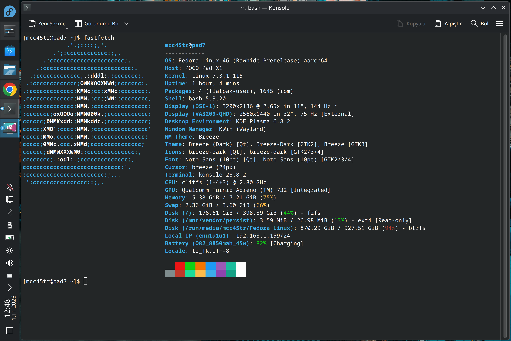

<table>
<tr>
<td width="65%" valign="top">
<h1>Uke Linux</h1>
<p><strong>Fedora Rawhide for POCO Pad X1 and Xiaomi Pad 7</strong></p>
<p>A community Linux port for the Snapdragon 7+ Gen 3 (SM7675), using standard Fedora userspace and KDE Plasma. Hardware development and validation focus on POCO Pad X1.</p>
<p><strong>Experimental alpha</strong> · AArch64 · <code>uke</code></p>
</td>
<td width="35%" valign="top" align="center">
<br>

</td>
</tr>
<tr>
<td colspan="2" align="center">

</td>
</tr>
</table>

[Downloads](#downloads) · [Hardware support](#hardware-support) · [Build from source](#build-from-source) · [Documentation](#documentation) · [Report a problem](CONTRIBUTING.md)

> [!WARNING]
> This is experimental alpha software, provided as is. Back up all data and retain the matching stock firmware before installing. Fastboot singleboot replaces `userdata` and `super`, erasing the existing Android installation and user data. Charging and hardware protection are not fully validated. Use at your own risk.

## Project status

**Last updated: 28 November 2026.**

Fedora Rawhide with KDE Plasma runs natively on the **POCO Pad X1 (8 GB RAM / 512 GB storage)**, reference device for Uke Linux. Internal O82 display supports 3200×2136 at up to 144 Hz, multiple resolutions and adaptive sync across 30–144 Hz. USB-C DisplayPort output reaches 4K60 over **HBR3 ×2 with DSC**, and HDMI video and audio work through tested Juo JH925 dock. Internal HDR10 playback with hardware-decoded P010 buffers and direct scanout passed focused tests at 60 and 144 Hz using the development HDR profile.

Touch, Wi-Fi, Bluetooth, automatic rotation and brightness, four-speaker audio at driver gain 223 (OSS 243), and microphone capture work in the tested configurations. Uke Control provides adaptive battery, hardware and sensor views, charging and display controls, and a Plasma effect that reduces blanking during resolution changes. Automatic A/B kernel staging and rollback have been exercised on the reference installation. Camera capture, protected higher speaker gain, 45 W charging, reliable suspend and hibernation remain under development. Intermittent DRM atomic `EBUSY` errors are still being investigated. See the [changelog](CHANGELOG.md) for earlier updates.

**Latest device-tested kernel:** `7.3.6-27-unstable`, booted through the stock Android bootloader. **Latest signed development build:** `7.3.6-28-unstable`, with a matching rescue package. The latter has been installed via DNF on the reference device, but boot staging and runtime validation remain pending. These development kernels are newer than the currently listed installation archives. [7.3.6-27 build](https://copr.fedorainfracloud.org/coprs/build/11401690/) · [7.3.6-28 build](https://copr.fedorainfracloud.org/coprs/build/11402249/) · [7.3.6-28 rescue](https://copr.fedorainfracloud.org/coprs/build/11402292/)

## Distribution roadmap

**Fedora Rawhide is the only active distribution port.** Development
uses the `Fedora` branch. An Ubuntu ARM64 test root is under development
and qualification; an Arch Linux edition is planned.

Earlier TEST and EL2/KVM work is retained in Git history for reference.
The `Fedora` branch records the reviewed component revisions. See the
[distribution roadmap and consolidated branch notes](DISTRIBUTIONS.md).

## Downloads

Fedora Rawhide KDE Plasma EXT4 singleboot test archives are available through GitHub Actions. Both use Linux 7.3.6-2; they do not include all features of the latest development kernel.

| Installation profile | Download | Notes |
| --- | --- | --- |
| Standard | [Fastboot ZIP](https://github.com/MCC45TR/uke-fedora-builder/actions/runs/45451327250/artifacts/14951675883) | Standard Uke boot image. |
| AVB-footer compatibility | [Fastboot ZIP](https://github.com/MCC45TR/uke-fedora-builder/actions/runs/45973040973/artifacts/15186650782) | Optional image for unlocked devices whose stock `vbmeta` chains the `boot` partition. Uses AOSP test-key AVB metadata, not an OEM-trusted secure boot chain. |

**Device compatibility:** The POCO Pad X1 is the reference device. For Xiaomi Pad 7, a community report confirms booting to KDE setup after adding an AVB footer with stock DTBO ([#18](https://github.com/MCC45TR/uke-linux/issues/18)). This does not validate the full compatibility archive, other firmware or storage variants, or the hardware support matrix below. Reports of boot, emergency input and UFS write failures remain relevant to installation safety; see [#14](https://github.com/MCC45TR/uke-linux/issues/14), [#19](https://github.com/MCC45TR/uke-linux/issues/19) and [#20](https://github.com/MCC45TR/uke-linux/issues/20). A UFS legacy-mode mitigation has passed ARM64 source checks but is not yet device-validated in a full kernel.

An unlocked bootloader and compatible stock firmware are required. Check the archive and its checksums, read the [Fastboot installation guide](https://github.com/MCC45TR/uke-fedora-builder/blob/main/docs/guides/userdata-fastboot.md), and keep only the selected installation ZIP in the working directory before running the command below. Actions downloads are time-limited; see the [builder workflows](https://github.com/MCC45TR/uke-fedora-builder/actions) if an artifact has expired.

```sh
fastboot update ./fedora*.zip
```

## Hardware support

The following tables apply **exclusively to the POCO Pad X1 (8 GB RAM / 512 GB storage)**, based on Fedora Rawhide AArch64 development builds tested between **14 October and 28 November 2026**. Results are cumulative across multiple kernels, not a qualification of every feature on a single release or on other device variants. Experimental profiles, focused tests and hardware validation limits are identified in the notes.

🟢 Working in the listed tests · 🟡 Partial · 🔴 Not working · ⚪ Not verified · ⏸️ Disabled

<details>
<summary><strong>Boot, CPU and storage</strong></summary>

| Feature | Status | Notes |
| --- | --- | --- |
| Fedora boot | 🟢 Working | Linux 7.3.6-27-unstable boots through the stock Android bootloader and passes the slot health check. Uke Plymouth and the KDE Plasma desktop render successfully. |
| CPU and power profiles | 🟢 Working | All eight cores and three CPU frequency policies work. Tested cluster maxima are approximately 1.90, 2.61 and 2.80 GHz; the Adreno GPU reached 950 MHz in performance tests. Power Saver and Balanced were exercised. Sustained thermal and performance testing remains open. |
| RAM | 🟢 Working | Linux reports about 7.2 GiB on the 8 GB tablet. Sustained memory stress and hibernation remain open. |
| UFS storage and EXT4 | 🟢 Working | Basic read/write integrity, WriteBooster, Hibern8 and dynamic gear transitions were verified on the fitted Kioxia UFS controller. HS-G4 Rate B ×2 was observed under load. Gear 5 operation and long-duration storage testing remain open. |
| UFS MCQ and inline encryption | 🟡 Partial | Nine MCQ queues are exposed on the fitted Kioxia controller. Qualcomm ICE and HWKM wrapped-key I/O passed a bounded write and readback on a dedicated test mapping. Full encrypted root, hardware-backed persistent key release and long-duration queue qualification remain open. |
| Memory bandwidth and cache monitoring | 🟡 Partial | CPU and DDR bandwidth monitors and eight cache counters respond. DPU bandwidth voting, DDR frequency residency and GPU load measurements were exercised. MEMLAT policy, counter calibration and quantified power savings remain open. |
| Reboot | 🟢 Working | Normal reboot returns to Fedora. Signed DNF updates automatically stage the inactive boot slot and retain the last accepted slot. A controlled failed boot successfully triggered rollback. |
| Shutdown | 🟢 Working | Plymouth appears during the shutdown sequence. Additional PMIC and remote processor shutdown diagnostics are included in the signed 7.3.6-28 candidate and await runtime testing. |
| Reboot to Fastboot | 🟢 Working | Bootloader entry and selection of a retained Linux slot were tested. |
| Reboot to recovery | 🟡 Partial | A matching Fedora Live Rescue environment was booted with a read-only, dm-verity-verified root. Recovery entry, authentication and repair behavior are not fully validated. |
| UEFI, EL2 and KVM | 🟡 Partial | Separate experimental U-Boot work launched Fedora at EL1 in a device test. UEFI, physical EL2 entry and KVM are not validated for the current Fedora port. |

</details>

<details>
<summary><strong>Display, graphics and input</strong></summary>

| Feature | Status | Notes |
| --- | --- | --- |
| Internal display | 🟢 Working | The fitted O82 panel supports native 3200×2136 output with DSC and additional desktop modes of 2400×1602, 2000×1335 and 1200×801. Internal HDR10 passed focused tests on a development profile. DSC-free panel modes remain experimental and did not produce usable output in the recorded raw-mode trials. |
| Fixed refresh rates | 🟢 Working | 30, 48, 50, 60, 90, 120 and 144 Hz were verified with physical display patterns. |
| Manual brightness | 🟢 Working | Native backlight adjustment works through Plasma and Uke Control. |
| Screen off/on | 🟢 Working | Display power cycling and DPMS resume were tested. Uke Control 2.17.0-68 includes a Plasma effect that retains the previous frame during resolution changes; tested transitions completed without observed blanking. This does not establish suspend/resume reliability. |
| Color depth | 🟡 Partial | 10-bit scanout and the O82 factory Display P3 profile were exercised. Development profiles passed BT.2020/PQ HDR10 and SDR hardware 3D LUT tests. Optical calibration, color accuracy and additional panel variants remain open. |
| Touchscreen | 🟢 Working | Finger and multi-touch input work with the fitted NT36532 panel firmware. Wet-touch filtering, pen interaction and repeated suspend/resume remain under development. |
| Adaptive sync / VRR | 🟢 Working | The internal display's 30–144 Hz range was exercised, including low-frame-rate behavior. Wider application and input coverage remains open. |
| KDE Plasma / Wayland | 🟢 Working | Accelerated Plasma and hardware cursor work. Smart DMA 2.5, display-plane exclusion rectangles and hardware writeback downscaling (WB2/DNSC) passed focused development tests. Internal HDR and zero-copy P010 presentation were demonstrated. Intermittent atomic EBUSY errors, frame pacing and broader multi-output tests remain open. |
| Adreno 732 / OpenGL | 🟢 Working | Hardware-accelerated OpenGL ES works through Freedreno. Adreno-rendered UBWC buffer import into DPU framebuffers was exercised; general UBWC scanout and application compatibility require further testing. |
| Vulkan / OpenCL | 🟡 Partial | Turnip ran Vulkan graphics, transfer and compute workloads. Vulkan variable-rate shading (VRS) capabilities were confirmed, and hardware GPU queue preemption passed focused tests. Full Vulkan conformance, VRS performance and OpenCL support remain open. |
| Browser graphics / WebGPU | 🟡 Partial | GPU compositing and browser hardware video decoding were tested. WebGPU, hardware encoding in browsers, and broader sandboxed operation remain open. |
| Power and volume buttons | 🟢 Working | Normal input works; waking from suspend is unverified. |
| Stylus | 🟡 Partial | Pen input works, but pressure sensitivity and tilt are not supported yet. |
| USB mouse | 🟢 Working | Tested with a receiver through the powered Juo dock. |
| USB and pogo keyboards | 🟡 Partial | USB keyboard enumeration works. Pogo authentication and desktop integration are packaged. Physical typing, touchpad and wake testing remain open. USB-C keyboard support in initramfs passed build-level checks; physical emergency-mode use remains unverified. |
| KDE Plasma on-screen keyboard | 🟢 Working | The standard Plasma on-screen keyboard works. A separate initramfs emergency touchscreen terminal, with Enter, arrow keys and Ctrl+D, passed signed ARM64 and Dracut checks and is included in newer Unstable builds. Physical emergency input remains unverified. |

</details>

<details>
<summary><strong>Networking, USB and external displays</strong></summary>

| Feature | Status | Notes |
| --- | --- | --- |
| Wi-Fi | 🟢 Working | Automatic connection, SSH and file transfers work. The driver advertises 6 GHz and Wake-on-WLAN capabilities; actual 6 GHz operation, preferred network offload and wake/resume behavior remain unverified. |
| Bluetooth | 🟢 Working | Mouse pairing, reconnection, LDAC stereo playback, and the saved KDE adapter state across reboot were tested. Headset microphone modes remain unverified. |
| KDE Connect discovery | 🟢 Working | Device discovery works; pairing and transfers need testing. |
| USB-C roles and accessory power | 🟡 Partial | Device mode, powered docks, and external peripherals work. Physical reconnect and USB-C role changes were exercised. Stable behavior across dock power changes and sleep remains open. |
| USB SuperSpeed | 🟡 Partial | The Juo JH925 hub and its Ethernet adapter enumerated at 5 Gbit/s. Sustained USB storage throughput and behavior across dock reconnects remain open. |
| USB serial and network gadgets | 🟢 Working | Optional CDC ACM console and ECM networking with SSH were tested. The gadget paths are off by default. |
| USB hubs | 🟢 Working | USB 2 and USB 3 peripherals were detected through the Juo JH925. Accessory power and hub behavior during reconnect and sleep remain under qualification. |
| USB-C video output | 🟢 Working | A directly connected Samsung M70F displayed 3840×2160 at 60 Hz over HBR3 ×2 with DSC alongside the internal O82 at 144 Hz in a recorded test. Juo JH925 HDMI separately passed 1440p60 at 10 bpc and 1440p75 at 8 bpc. HDMI-CEC and reconnect reliability remain under qualification. |
| External HDR | 🟢 Working | Plasma HDR output was tested at 1440p60. A separate direct connection displayed 4K30 HDR together with the internal O82 at 144 Hz. Simultaneous 4K60 HDR and native internal 144 Hz exceeded the tested DSC allocation; broader HDR modes and accuracy remain open. |
| MST and four-lane DisplayPort | 🟡 Partial | Juo JH925 drove two external displays at 1080p60 and 1440p75 over HBR3 ×2 in a closed-cover layout. A direct ViewSonic connection negotiated HBR2 ×4. HBR3 ×4, dual high-resolution displays and simultaneous internal plus two high-resolution external displays remain unverified. |
| External DSC/FEC | 🟢 Working | A direct Samsung connection passed 4K60 over HBR3 ×2, using 12 bpp DSC with RGB 8 bpc in a focused single-external-display test with the internal panel disabled. FEC counters were readable, with zero uncorrectable blocks in sampled runs. 12 bpp MST and higher-bandwidth combinations are not yet physically validated. |
| Monitor brightness over DDC/CI | 🟢 Working | Monitor brightness control via DDC/CI has been repeatedly verified on a ViewSonic VA3209-2K-MHD. Compatibility through HDMI adapters and docking stations may vary. |
| USB Ethernet | 🟢 Working | The Juo RTL8153 negotiated a 1 Gbit/s Ethernet link. Sustained throughput and receive drops remain under investigation. |
| NFC tag interface | 🟡 Partial | The POCO-specific tag driver registers and a bounded I2C read passes. External RF transfer remains unverified; this is not reader support. |
| Infrared transmitter | ⚪ Not verified | The transmitter registers; optical output and receiver response remain untested. |

</details>

<details>
<summary><strong>Sensors and desktop integration</strong></summary>

| Feature | Status | Notes |
| --- | --- | --- |
| Screen rotation | 🟢 Working | Manual and automatic rotation work with matching touch coordinates in all four orientations. |
| Automatic brightness | 🟢 Working | The display responds to the front and rear light inputs. Fitted-sensor and low-light tuning remain under qualification. |
| Front proximity sensor | 🟢 Working | The native sensor interface reports near and far states. |
| Gyroscope and compass | 🟡 Partial | Native IIO exposes motion and sensor-fusion data. Gravity, linear acceleration and game-rotation quaternion samples were verified before and after s2idle. Physical compass accuracy, magnetic rotation and calibration remain open. |
| Magnetic cover detection | 🟢 Working | Cover open/close events and closed-cover display layouts were tested. Uke Control implements optional cover-triggered switching to two external displays; automated switching passed modeled and isolated desktop tests, while complete physical validation remains open. |
| Ambient color temperature | 🟡 Partial | Front color-sensor readings drove the optional O82 ambient white-balance adjustment in device tests. Absolute Kelvin calibration, optical color accuracy, and smooth transitions remain open. |
| Light flicker sensing | 🟡 Partial | Seven raw values were observed in sensor development. Calibrated frequency reporting and the Linux interface remain under qualification. |
| SAR / body proximity | ⏸️ Disabled | No usable sensor response. |

</details>

<details>
<summary><strong>Audio, cameras and video</strong></summary>

| Feature | Status | Notes |
| --- | --- | --- |
| Internal speakers | 🟢 Working | Four-speaker playback and channel routing were tested at gain 223. Calibrated voltage and current feedback, limiter behavior, and protected gain 243 remain under development. |
| Microphones | 🟢 Working | Internal microphone recording and four-channel capture passed device tests. The AudioReach backend acknowledged stream stop before microphone power-down in the tested path. |
| Bluetooth and HDMI audio | 🟢 Working | Stereo playback was tested with Space Q45 headphones and with a monitor through Juo JH925. |
| USB audio | 🟢 Working | USB audio playback and recording passed device tests. |
| Front and rear cameras | 🔴 Not working | Front sensor identification and read-only calibration EEPROM access were verified. Usable camera streams and rear autofocus remain under development. |
| Native hardware video | 🟢 Working | Qualcomm Iris hardware decoding and encoding work in tested modes. H.264, HEVC and VP9 passed dynamic-resolution decode tests; H.264 UHD at approximately 63.5 fps and HEVC UHD at 64 fps passed bounded encoding tests. HEVC Main10 encoding and decoding were exercised. Internal P010 HDR10 direct scanout passed at 60 and 144 Hz. AV1 hardware is disabled on the tested SKU; ROI encoding and HDR10+ metadata integration remain open. |
| VA-API and browser video | 🟡 Partial | Short VA-API hardware decoding and browser hardware video tests passed. A five-minute Chrome 4K60 run recorded dropped frames. Browser encoding, HDR and sustained playback/frame pacing remain under qualification. |

</details>

<details>
<summary><strong>Battery, power and platform services</strong></summary>

| Feature | Status | Notes |
| --- | --- | --- |
| Battery and temperature readings | 🟢 Working | Charge level, voltage, current, power, temperature and battery health are available. Plasma reports battery status; Uke Control provides history and charging controls. Energy estimates and calibration remain open. |
| USB charging / Power Delivery | 🟡 Partial | Direct USB charging and powered-dock charging were tested. PD-capable adapters were detected. Sustained 45 W charging and the full range of negotiated contracts need electrical verification. |
| Charge limits | 🟡 Partial | Uke Control reads and configures firmware charge thresholds. Charge stop near the configured upper limit was observed. Restart behavior and full hysteresis cycles across charge presets still need verification. |
| Charging protection | 🟡 Partial | Automatic startup of the protection service was verified with the native battery and USB power providers. Battery, charger and USB-C temperature readings are available. Physical electrical cutoff, moisture detection and fault response are not yet validated. |
| Battery bypass | ⚪ Not verified | Low net battery current was measured with dock power. Battery isolation and direct system power remain unverified. |
| Offline charging | 🔴 Not working | The reported power-off behavior still boots Fedora when external power is connected. A reliable charging-only flow remains under development. |
| Suspend-to-idle | 🟡 Partial | RTC wake, native sensor samples after resume, and return to the previous display power state passed bounded tests. Repeated wake, dock and Wi-Fi recovery, and sleep power use remain under qualification. |
| Deep suspend and input wake | ⚪ Not verified | Deep sleep and reliable power-button, keyboard, and USB input wake remain unverified. |
| Hibernation | 🔴 Not working | Partition-backed swap and zswap were tested. A protected hibernation resume path remains under development. |
| USB cable wake | 🔴 Not working | A reliable wake from USB cable insertion remains open. |
| Thermal protection | 🟢 Working | Runtime temperature monitoring and CPU and GPU limits work in the tested profiles. Full charging and thermal fault validation remains open. |
| RGB notification LED | 🟢 Working | Basic RGB output and Uke Control color and brightness controls were tested. Broader notification behavior remains under qualification. |
| Flashlight | 🟢 Working | On, off, 50%, and 100% were tested from the Uke Control desktop interface as a regular user. |
| Clock | 🟡 Partial | Saved time is restored before network synchronization, and RTC alarm wake has passed device tests. The raw PMIC counter is no longer treated as UTC during boot; independent accurate hardware wall-clock retention remains unverified. |
| PMIC, DSP and platform services | 🟡 Partial | ADSP, WPSS and PMIC GLINK services run, with bounded ADSP recovery support. RPMh and DDR telemetry have been exercised. The signed 7.3.6-28 candidate adds further PMIC, remote processor and CPUCP diagnostics. CDSP compute and broader restart qualification remain open. |
| CoreSight tracing | ⏸️ Disabled | Disabled after earlier resets. |

</details>

## Build from source

```sh
git clone --branch Fedora --recurse-submodules https://github.com/MCC45TR/uke-linux.git
cd uke-linux
./ukelinux.sh
```

To update an existing workspace from this repository:

```sh
git pull --ff-only --recurse-submodules
git submodule update --init --recursive
```

The components track the branches declared in `.gitmodules` (`main`, or `R12.0`
for OrangeFox). The hourly workspace workflow updates their recorded revisions
after validation. To follow the component branch tips immediately, run
`git submodule update --init --remote --checkout`. Keep local component changes
committed or stashed before updating. Git submodules always record a commit in
the parent; branch tracking and the refresh workflow advance that record.

For a kernel-only build:

```sh
./ukelinux.sh --build kernel
```

The build menu includes desktop, filesystem, boot layout and package channel options. Output is saved to `out/` in the working directory. The builder supports Fedora and compatible non-Fedora hosts, including Ubuntu, Debian and Linux Mint. Fedora SELinux policies and filesystem labels are prepared and checked inside the build environment; SELinux is not required on the host. An x86_64/QEMU `semodule` timeout remains under investigation. [Public build guide](https://github.com/MCC45TR/uke-fedora-builder/blob/main/docs/PUBLIC-BUILD.md) · [Issue #17](https://github.com/MCC45TR/uke-linux/issues/17)

### Manual GitHub image builds

Open [EXT4 singleboot image and release](https://github.com/MCC45TR/uke-linux/actions/workflows/image-release.yml)
and select **Run workflow** on `Fedora`. Choose KDE Plasma, GNOME, Cutefish
or Plasma Mobile, a login shell, and an initial 16 GiB or 8 GiB filesystem
(16 GiB is the default). The workflow uses the Unstable channel.
`latest` resolves the current Unstable kernel once per run.
You can also supply an exact `7.3.x-N.fc46` version.

The workflow uses a native Ubuntu ARM64 runner to compose images from signed
packages. The [Cutefish workflow](https://github.com/MCC45TR/uke-linux/actions/workflows/cutefish-image.yml)
checks source contracts and host capacity; its `compose` job produces test
artifacts. Cutefish and Plasma Mobile still require physical first-login and
device validation. The separate [Fastboot builder workflow](https://github.com/MCC45TR/uke-fedora-builder/actions/workflows/source-contracts.yml)
offers the optional `fastboot_boot_avb` profile. Optional publication creates an
image-only pre-release. The hosted image workflow retains image downloads for
seven days and manifests/build receipts for 90 days. Successful composition or
CI checks do not establish physical boot, first-account setup, charging or recovery.

### Updates

After the first Fedora boot, update from the configured signed repositories:

```sh
sudo dnf update --refresh
```

Keep the kernel, modules, device trees and boot profile matched. On the validated
standard installation, the updater stages a signed matching boot image to the
inactive slot and retains the previously accepted slot for rollback. Boot-slot
rollback does not restore the shared root filesystem or user data.
Wait for staging to complete before rebooting; then check the running version
with `uname -r`. The AVB-footer profile is not yet validated for automatic kernel
staging, and RAM-only Fastboot rescue is firmware-dependent. Follow the
[Fastboot and update guide](https://github.com/MCC45TR/uke-fedora-builder/blob/main/docs/guides/userdata-fastboot.md)
for the installed profile.

## Documentation

| Topic | Link |
| --- | --- |
| Builds and installation | [Public build guide](https://github.com/MCC45TR/uke-fedora-builder/blob/main/docs/PUBLIC-BUILD.md) · [Manual installation and rollback](https://github.com/MCC45TR/uke-fedora-builder/blob/main/docs/PUBLIC-BUILD.md#output-and-manual-installation) |
| Development updates | [Changelog](CHANGELOG.md) |
| Distribution roadmap and archived branches | [DISTRIBUTIONS.md](DISTRIBUTIONS.md) |
| Screenshots | [Fedora KDE gallery](assets/screenshots/README.md) |
| Contributions and bug reports | [Contributing guide](CONTRIBUTING.md) · [Open an issue](https://github.com/MCC45TR/uke-linux/issues/new?template=bug_report.yml) |
| Security reports | [Security policy](SECURITY.md) |

<details>
<summary>Maintainer notes — access required</summary>

[Development plan](https://github.com/MCC45TR/uke-linux-docs/blob/main/PLAN.md) · [Engineering records](https://github.com/MCC45TR/uke-linux-docs/blob/main/docs/README.md)

</details>

## Project repositories

| Component | Repository |
| --- | --- |
| Kernel and device trees | [senemos-uke-kernel-mainline](https://github.com/MCC45TR/senemos-uke-kernel-mainline) |
| Hardware integration and packages | [uke-linux-hardware-support](https://github.com/MCC45TR/uke-linux-hardware-support/tree/main) |
| Image builder | [uke-fedora-builder](https://github.com/MCC45TR/uke-fedora-builder/tree/main) |
| Image distribution | [uke-linux-images](https://github.com/MCC45TR/uke-linux-images/tree/main) |
| Desktop environment packaging | [uke-desktop-environment-support](https://github.com/MCC45TR/uke-desktop-environment-support/tree/main) |
| OrangeFox Recovery | [orangefox_device_xiaomi_uke](https://github.com/MCC45TR/orangefox_device_xiaomi_uke/tree/R12.0) |
| Experimental UEFI | [uke-project-aloha](https://github.com/MCC45TR/uke-project-aloha/tree/main) |

These links follow development branches. The submodules track the branches in `.gitmodules`; the workspace refresh workflow advances their recorded revisions after validation.

## Thanks

Thanks to [RealDexxo](https://github.com/RealDexxo) for work on speaker support and improvements to the build scripts.

## License

Original files are covered by the [MIT License](LICENSE). Components retain their own licenses and attribution.

Uke Linux is an independent community project, unaffiliated with Fedora, Xiaomi, POCO, or Qualcomm.
